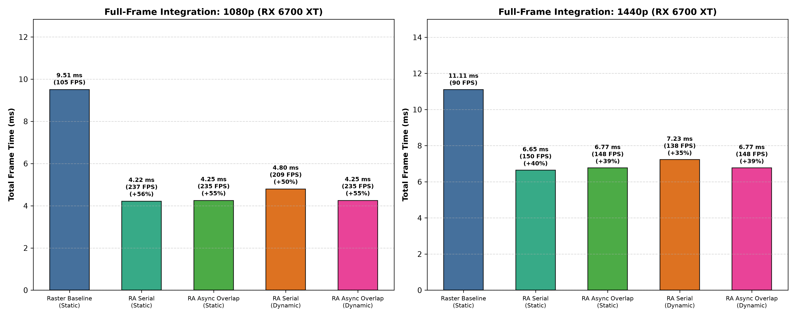
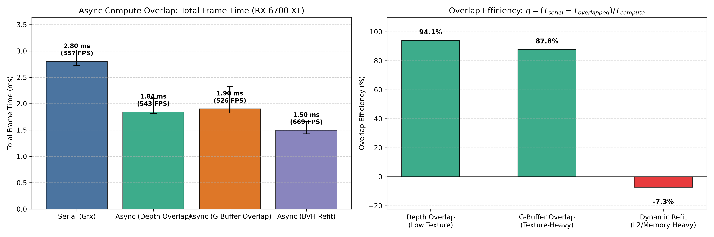
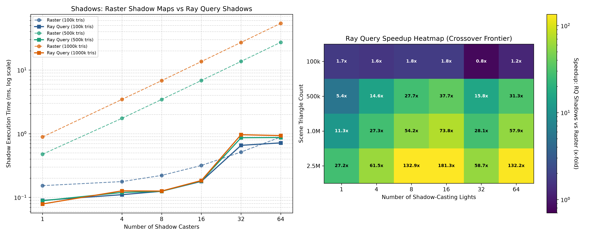
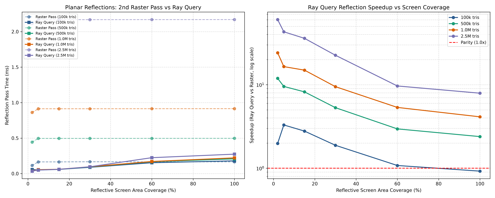

# RDNA2 Ray Accelerator Research: Repurposing RT Hardware for Rasterized Frames

[](https://www.vulkan.org/)
[](https://www.amd.com/)
[-orange.svg)](https://docs.mesa3d.org/drivers/radv.html)
[](LICENSE)

An empirical research suite and benchmarking framework investigating whether AMD RDNA2 dedicated Ray Accelerators (RA) can raise FPS in modern rasterized graphics workloads on Linux using Vulkan ray queries (`VK_KHR_ray_query`) and Mesa RADV.

---

## Key Highlights & Findings

For the complete forensic audit, methodology, crossover analyses, and data tables, see [**`REPORT.md`**](REPORT.md).

```
                                  RDNA2 WORKLOAD VERDICTS
  ┌───────────────────────────────────────────────┬───────────────────────────────────────────────┐
  │              WHERE THE RA WINS                │              DO NOT BOTHER (LOSSES)           │
  ├───────────────────────────────────────────────┼───────────────────────────────────────────────┤
  │ • Shadows with ≥4 Casters: Up to 132x speedup │ • Dynamic BVH Refit on Async: Memory bus/L2   │
  │ • Async Overlap with Depth: 94% efficiency    │   contention causes -7.3% efficiency drop.    │
  │ • Planar Reflections: Up to 60x speedup       │ • Screen-Space Reflections (SSR): SSR is      │
  │ • Ambient Occlusion (RQAO): +19.7 dB PSNR at  │   0.08 ms vs RQR 0.42 ms (quality cost).      │
  │   equal frame time (0.50 ms)                  │ • Many-Light Shading: Tiled LDS is 3x–7x      │
  │ • Full-Frame Pipeline: +125% FPS at 1080p     │   faster than Ray Query light lookup.         │
  │   (2.25x speedup, 237 vs 105 FPS)             │ • Primary Visibility with Active LOD:         │
  │                                               │   Mesh shaders match RQ with 0 MB BLAS.       │
  └───────────────────────────────────────────────┴───────────────────────────────────────────────┘
```

### Full-Frame Benchmark Comparison (1080p & 1440p)
| Resolution | Raster Baseline | RA-Assisted (Serial) | RA-Assisted (Async Overlap) | Dynamic Scene (+Refit) | Speedup / Gain |
| :--- | :--- | :--- | :--- | :--- | :--- |
| **1080p** | 9.51 ms (105 FPS) | **4.22 ms (237 FPS)** | **4.25 ms (235 FPS)** | **4.80 ms (208 FPS)** | **+125.5% FPS (2.25x)** |
| **1440p** | 11.11 ms (90 FPS) | **6.65 ms (150 FPS)** | **6.77 ms (148 FPS)** | **7.23 ms (138 FPS)** | **+67.1% FPS (1.67x)** |

---

## Visual Benchmark Results

<p align="center">
  
  
</p>
<p align="center">
  
  
</p>

---

## Repository Structure

- [`common/`](common/): Vulkan context initialization, dual-queue timer (`DualQueueTimer`), async compute queue management, BLAS/TLAS builders, GLSL compilation via shaderc, and PSNR/SSIM image metrics.
- [`expA_async/`](expA_async/): Async compute overlap benchmarks and TMU contention tests.
- [`expB_shadows/`](expB_shadows/): Dynamic shadow caster sweep ($1$ to $64$ lights, $100\text{k}$ to $2.5\text{M}$ triangles).
- [`expC_reflections/`](expC_reflections/): Planar mirror reflector sweep across screen coverage % and scene geometry.
- [`expD_screenspace/`](expD_screenspace/): Screen-space effects replacement (SSAO vs RQAO, SSR vs RQR, SSCS vs RQCS).
- [`expE_fullframe/`](expE_fullframe/): Full realistic deferred frame integrating shadows, reflections, and AO.
- [`exp0_probe/`](exp0_probe/): Hardware Ray Accelerator capability probes and microbenchmarks.
- [`exp1_visbuf/`](exp1_visbuf/): Visibility buffer subpixel rasterization vs ray-query benchmarks.
- [`exp2_occlusion/`](exp2_occlusion/): Occlusion culling showdown: Ray Query vs Temporal HZB.
- [`exp3_spatial/`](exp3_spatial/): Spatial lighting data structures vs Clustered/Tiled deferred shading.
- [`exp4_integration/`](exp4_integration/): Earlier many-light radius sweep integration suite.
- [`scripts/`](scripts/): Automated Python plotting scripts using Matplotlib and NumPy.
- [`results/`](results/): Raw CSV data dumps and publication-quality generated figures.

---

## Building and Running

### Prerequisites
- **OS:** Linux (`x86_64`)
- **GPU:** AMD Radeon RX 6000 series (RDNA2) or newer
- **Vulkan Driver:** Mesa RADV (`vulkan-radeon`) with `VK_KHR_ray_query` support
- **Dependencies:** CMake 3.20+, GCC / Clang (C++20), Vulkan SDK (`vulkan-headers`, `spirv-tools`, `shaderc`), Python 3 with `matplotlib` and `pandas`

### Build and Run All Experiments
```bash
# Clone the repository
git clone https://github.com/<username>/racores.git
cd racores

# Run the complete test suite (compiles binaries, runs all 10 benchmarks, outputs plots)
./run_all.sh
```

---

## Detailed Report

For the in-depth forensic analysis, full methodology, and architectural breakdown, refer to [**`REPORT.md`**](REPORT.md).
